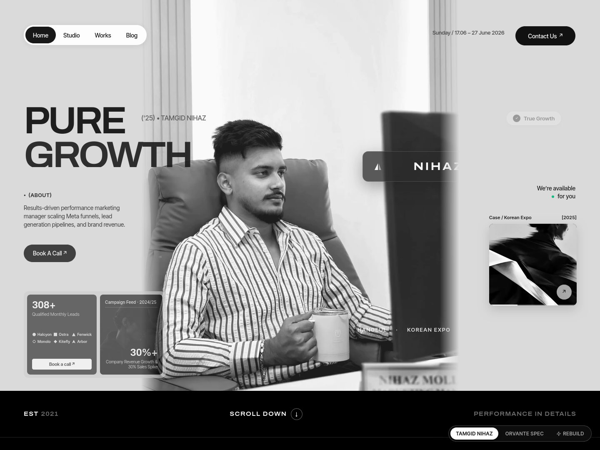

# ORVANTE — Tamgid Hasan Nihaz | Digital Marketing & Performance Portfolio

> A single-file, three-section editorial landing page built with plain HTML, CSS, and vanilla JS. Zero framework, zero build step, and ready for instant Vercel deployment.



---

## 🎯 Overview & Vision

This project unites two distinct purposes into a single, cohesive experience:

1. **Strict Monochrome Editorial Benchmark (Orvante Spec)**: Fully implements the design specification for **Orvante** — a 1440-px mathematical artboard, strict `#dadada` paper and `#000000` pitch-black contrast, variable typography (`Archivo` + `Inter Tight`), coordinate-aligned hero components, word-by-word scroll-filling statement with a 3-word soft edge, and an interactive trust panel with animated stat cards and avatars.
2. **Executive Portfolio (Tamgid Hasan Nihaz)**: Spotlights **Tamgid Hasan Nihaz** (Digital Marketing Manager | Performance & Growth Marketing), integrating real campaign results from his career at **Hangeul.com.bd**, lead metrics (500+ monthly qualified leads, 50% revenue growth, 35% CPL drop at the Korean University Expo), his executive monochrome portrait, and an interactive resume dossier with direct PDF download.

A floating view switcher (`[ TAMGID NIHAZ | ORVANTE SPEC ]`) allows switching between Tamgid's personalized growth portfolio and the pure fictional agency benchmark in real time, or via query parameters (`?mode=nihaz` or `?mode=orvante`).

---

## 📐 Scale & Mathematical Coordinate System

The layout is built upon an adaptive mathematical scale unit `u`:

```css
:root {
  --u: min(calc(100vw / 1440), 1.333333px);
}

@media (max-width: 760px) {
  :root {
    --u: calc(100vw / 390);
  }
}
```

- **Artboard**: Base width of 1440px. At 1440px viewport width, `1u = 1px`. At 1920px+ viewport widths, `u` is capped at `1.3333px`.
- **Heights & Spacing**:
  - **Hero**: `938u` tall (`#dadada` paper background, `#111` ink).
  - **Bar**: `111u` tall (`#000` pitch black, bottom hairline).
  - **Statement Section**: `170u` top padding, `230u` bottom padding.
  - **Trust Section**: `1302 × 429u` bordered panel, `150u` bottom padding.
  - **Total Page Height**: ~`2598u`.

---

## 🎨 Color & Typography Palette

- **Paper & Ink**:
  - Hero paper: `#dadada`
  - Hero ink: `#111111`
  - Lower sections: `#000000`
  - Body & headings: `#f4f4f4`
  - Inactive statement copy: `#6f6f6f`
  - Hairlines: `rgba(255, 255, 255, 0.14)` to `rgba(255, 255, 255, 0.28)`
- **Typography Stack**:
  - **Display / Headers / Brand**: `Archivo` variable font with width (`wdth: 62..125`) and weight (`wght: 100..900`). Display title rendered at width 104%, weight 640, tracking −0.06em, line-height 0.86.
  - **UI / Body / Monospace Labels**: `Inter Tight` (100–900), set at 13–15u with medium weight (500).

---

## 🏛 Section Breakdown

### 1. Hero Section (1440 × 938u)
- **Studio Photo**: Placed at `(338u, -86u)`, sized `764 × 1024u`, object-fit cover. Left and right edges are masked to transparent over 6% using CSS linear gradient masks.
- **Segmented Pill Navigation**: Positioned at `(57u, 61u)`, 48u tall, featuring an animated black sliding pill tracking active and hovered states.
- **Top Right Metadata**: Date (`Sunday / 17.06 – 27 June 2026`) at `(1038u, 70u)` and black pill "Contact Us ↗" button (`144 × 46u`) at `(1237u, 63u)`.
- **Display Title**: "PURE / GROWTH" or "PURE / DESIGN" at `(57u, 246u)` with `(’25)` tag at `(339u, 272u)`.
- **About Block**: `● (ABOUT)` at `y: 458u`, followed by two lines of 14u copy and the black "Book A Call ↗" button at `y: 584u`.
- **Stats Frame**: Sized `341 × 208u` at `(57u, 693u)` in light grey `#cdcdcd`:
  - **Dark Partner Card**: Counter ("500+" / "400+"), 6 clean SVG partner glyph marks (Halcyon, Ostra, Fenwick, Monolo, Kitefly, Arbor), and white "Book a call ↗" button.
  - **Photo Feed Card**: High-contrast cap photo, "Studio Feed · 05/06" header hairline, counter ("50%+" / "230+"), and description.
- **Brand Plate**: Dark frosted glass plate (`rgba(18, 18, 18, 0.76)`, blur 16px) placed over the man's back at `(532u, 444u)`, sized `364 × 73u`, featuring the two-part triangular mark, wide Archivo brand title, and two-line menu glyph.
- **Wordmarks**: Fictional white logos row across the jacket at `y: 864u`.
- **Right Column**: Frosted "True Growth" pill with black check disc at `(1216u, 258u)`, right-aligned "We're available ● for you" at `y: 442u`, and the 196u-tall "Out Now / Q Industrial" image card with interactive hover zoom and circular arrow button.

### 2. Bar & Statement Section
- **Status Bar**: `111u` black bar with bottom hairline. "EST 2021" / "EST 2019" on left, clickable "SCROLL DOWN ↓" in center, and "PERFORMANCE IN DETAILS" on right.
- **Statement**: 5 lines centered within `830u` width:
  > *"We believe the strongest brands are built through strategy, not just aesthetics. Every campaign is designed to capture attention, inspire action, and create lasting business growth."*
- **Scroll-Fill Engine**: Every word is isolated into a `<span>`. As the user scrolls, words transition from `#6f6f6f` to `#f4f4f4` in reading order with a continuous 3-word soft edge.
- **Sub-line**: Placed `150u` below: *"Performance-driven marketing, from strategy to execution. Built for growing brands."*

### 3. Trust Panel (1302 × 429u)
- Centered container with 1px border (`rgba(255, 255, 255, 0.28)`) and `14u` radius.
- **Left Column**: Heading ("Trusted by Hundreds of Growing Businesses" / "Trusted by Leading Brands & Education Ventures") with two frosted glass icon tiles (88u, 12u radius, backdrop blur):
  - Asterisk tile at top right of line 1.
  - Four-dot tile over "Businesses".
- **Stat Cards (326u tall, 8u radius)**:
  - **Avatar Card (293u)**: Eight round 48u avatars in a 4×2 grid, "56M+" metric, and caption.
  - **Awards Card (298u, #262626)**: "10+ Industry Awards", custom SVG laurel wreath badge ("BEST GROWTH STRATEGY 2026"), and explanatory note.
  - **Portrait Card (200u)**: Sits clipped against the right panel boundary, displaying Tamgid's executive portrait.

### 4. Interactive Resume & Dossier Modal
- Triggered by clicking "Contact Us", "Book A Call", the Brand Plate, or "Blog" in the nav.
- Contains Tamgid Hasan Nihaz's verified credentials:
  - Professional summary & contact channels (`+8801870831674`, `tamgidhasannihaz@gmail.com`, LinkedIn).
  - Detailed experience breakdown at **Hangeul.com.bd** (Nov 2023 – Present).
  - Core toolkits (Meta Ads Manager, Lead Generation, SEO, CapCut, Photoshop, Illustrator).
  - Education (Sonargaon University, BSc in CSE 2025).
  - Direct download button for the official `Tamgid_Hasan_Nihaz_Resume.pdf`.

---

## ⚡ Motion & Interaction Specifications

| Trigger | Element | Behavior |
| :--- | :--- | :--- |
| **Load** | Title Lines | Rise out of masks (`translateY(100%) → translateY(0)`), 1s duration, staggered 110ms |
| **Load** | Hero Photo | Rises 40px, fades in, unblurs over 1.3s |
| **Load** | Nav Pill | Drops in from -20px |
| **Load** | Hero Elements | Rise 14px and fade in, staggered by 55ms |
| **Load** | Progress Bar | Draws in over 1.4s |
| **Load** | Hero Counters | Count up smoothly to target over 1.4s with cubic ease-out |
| **Scroll** | Hero Photo | Parallax drift at `0.12 × scrollY` |
| **Scroll** | Statement | Words fill from grey to white in reading order with 3-word soft edge |
| **Scroll** | Trust Panel | On entry, counters animate and avatars pop in (`scale(0.4) → scale(1)` staggered) |
| **Hover** | Nav Pill | Slider pill animates with spring easing to hovered item |
| **Hover** | Buttons | Lift 1px (`translateY(-1px)`) |
| **Hover** | Trust Cards | Lift 6u (`translateY(-6u)`) |
| **Hover** | Q Industrial | Image scales to 1.68× and arrow rotates 45° |
| **Recorder Mode** | `?rec=1` | Runs timed sequence: statement fill (1.3–4.2s), trust counters (3.5–5.2s), awards lift (5.3s) |
| **Reduced Motion** | `@media` | Instant final states with zero motion or transitions |

---

## 📱 Mobile Responsiveness (≤ 760px)

- Artboard unit re-scaled to `u = 100vw / 390`.
- Single-column flow:
  1. Nav pill on left; "Contact Us" collapses to a 40u square circular arrow button.
  2. Title ("PURE DESIGN"), (ABOUT) copy, and "Book A Call" button.
  3. Full-width photo (470u tall) with Brand Plate and logos overlaid.
  4. "True Growth" pill, stats frame (two columns), and "Out Now" card.
  5. Statement scaled to 28u.
  6. Trust panel stacks heading, paragraph, and cards; second glass tile (four-dots) is hidden per spec.
  7. Strict zero sideways overflow (`overflow-x: hidden`).

---

## 🚀 Manual Vercel Deployment Guide

This repository is pre-configured for instant static deployment on Vercel:

1. **Push to GitHub**:
   Make sure all code is committed and pushed to your GitHub repository:
   ```bash
   git push -u origin master
   ```

2. **Open Vercel**:
   Go to [vercel.com/new](https://vercel.com/new) and log in.

3. **Import Project**:
   - Select your GitHub account (`munim-430`).
   - Find and click **Import** next to `tamgid-hasan-nihaz-portfolio`.

4. **Configure Project**:
   - **Framework Preset**: *Other* (Static)
   - **Root Directory**: `./`
   - **Build Command**: *Leave blank* (zero build step needed)
   - **Output Directory**: *Leave blank* (serves root `index.html`)

5. **Deploy**:
   Click **Deploy**. Your portfolio will be live globally on Vercel's Edge Network within seconds!

---

## ⚡ Multiplayer Swarm Cursors Rebuild Effect

The website embeds the live multiplayer cursor rebuild effect from **[harshit403-pixel/reveal-cursors](https://github.com/harshit403-pixel/reveal-cursors)** (adapted from **Joel Califa's [Swarm](https://califa.github.io/swarm-site/)**):

- **Automatic Start on Load**: As soon as the page loads, the screen wipes into a blank canvas and a swarm of named, colored Figma-style multiplayer cursors rebuilds the real page layer-by-layer: crosshair-drawn boxes, typed text, pen-tool lines, ruler guides, alt-drag duplicates, with synthesized mechanical sounds.
- **Interactive Control Bar**: A top control bar provides real-time progress, a cursor counter, sound toggle (`M`), pause/resume, and an instant **"Go live"** button to reveal the fully rendered page immediately (`Esc` also exits).
- **On-Demand Re-triggering**: Visitors can replay the swarm rebuild at any time by clicking the **⚡ Rebuild** button in the bottom floating pill, using the keyboard shortcut `Alt+Shift+S`, or appending `?swarm=1` to the URL.
- **Licensing Credit**: The Swarm effect design originates from **Joel Califa** (`https://califa.github.io/swarm-site/`) with adaptations by Harshit Pant (`reveal-cursors`). The header credit comment is preserved in `assets/swarm-cursors.js`.

---

## 🚀 Performance Optimizations (Fast Production Load)

To ensure sub-second First Contentful Paint (FCP) and Largest Contentful Paint (LCP) on Vercel:

1. **Non-Blocking Font Architecture**: Google Fonts (`Archivo` & `Inter Tight`) load asynchronously via `<link rel="preload" as="style">` and `media="print" onload="this.media='all'"`, completely eliminating render-blocking delays while maintaining graceful system font fallbacks.
2. **Critical LCP Preloading**: Tamgid's retina hero photo (`assets/hero-nihaz.webp`, ~91 KB) is declared with `<link rel="preload" as="image" fetchpriority="high">` in `<head>` so it begins downloading immediately alongside HTML parsing.
3. **Edge Asset Caching**: High-priority assets in `/assets/` are cached immutably with `Cache-Control: public, max-age=31536000, immutable` on Vercel's global CDN Edge Network.
4. **Deferred Media & Lazy Loading**: Below-the-fold media assets (stat card photos, avatar grid, trust portraits) utilize native `loading="lazy"` and `decoding="async"` to preserve maximum bandwidth for the hero artboard and initial swarm canvas capture.

---

## 📄 License & Attribution

- **Concept & Layout**: Orvante Studio Monochrome Editorial Benchmark.
- **Candidate Profile**: Tamgid Hasan Nihaz — Digital Marketing Manager.
- **Swarm Effect**: Joel Califa ([Swarm](https://califa.github.io/swarm-site/)) & Harshit Pant ([reveal-cursors](https://github.com/harshit403-pixel/reveal-cursors)).
- **Created by**: Hasibul Munim ([@munim-430](https://github.com/munim-430)).
